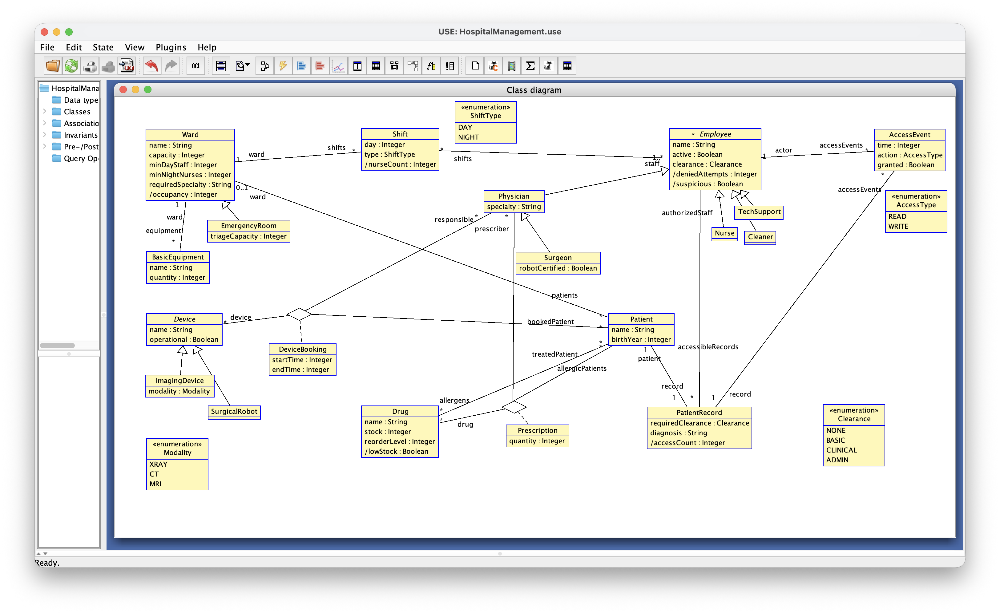
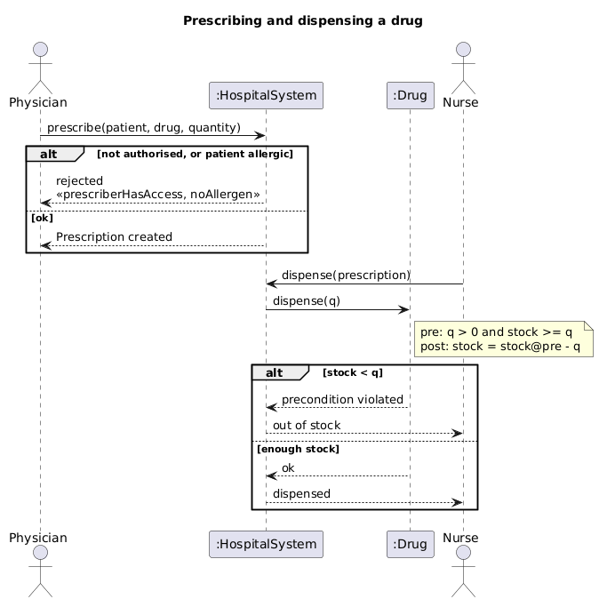

# Hospital Management System

### Solution documentation (Task 2)

## 1. Overview

Domain: a hospital management system, modeled after large Czech hospitals such as Fakultní nemocnice Motol and Všeobecná fakultní nemocnice v Praze (VFN).

The model covers the parts of a hospital that matter for safe operation: personnel with different roles and their shifts, wards (including an emergency room), patients and their records with access control, equipment (basic and advanced devices) and the scheduling of devices, and the drug inventory with prescriptions. The focus is on rules that avoid unsafe situations (too few staff at night, running out of drugs, prescribing a drug to an allergic patient) and on security (who may read a patient record, and a log of every attempt to do so).

Included files:

- [models/HospitalManagement.use](../models/HospitalManagement.use): a UML class diagram with OCL constraints, written in the UML-based Specification Environment (USE, https://github.com/useocl/use)
- [models/scenario.soil](../models/scenario.soil): a USE script that builds a valid state and then applies deliberate violations, used to check the OCL constraints
- [models/sequence_prescribe_dispense.puml](../models/sequence_prescribe_dispense.puml) (rendered: [sequence_diagram-prescribing_drug.png](../sequence_diagram-prescribing_drug.png)): a sequence diagram describing the process of a doctor prescribing a medicine to a patient and the subsequent dispensing of the medicine by a nurse, written in PlantUML
- [src/](../src): a small Java (Maven) prototype of part of the model, described in the Task 5 document

## 2. Class diagram

### 2.1 Main entities

**Organisation**: `Ward` has a name, a capacity and staffing parameters: `minDayStaff` (people needed on a day shift), `minNightNurses` (nurses needed on a night shift) and `requiredSpecialty` (a medical specialty that every shift of the ward must cover, empty if none). `EmergencyRoom` is a special kind of ward with a triage capacity. A `Shift` belongs to one ward and has a day number and a type (`DAY` or `NIGHT`).

**Personnel**: `Employee` is an abstract class (name, active flag, security clearance) with the subclasses `Physician` (with a specialty), `Nurse`, `Cleaner` and `TechSupport`. `Surgeon` is a special kind of physician who additionally records whether they are certified to operate a surgical robot.

**Patients and records**: A `Patient` (name, birth year) has exactly one `PatientRecord` (diagnosis and the clearance level needed to read it). The records are the sensitive part of the system, so who may read which record is modeled explicitly.

**Audit log**: An `AccessEvent` records one attempt of an employee to access a patient record: the time, the kind of access (`READ` or `WRITE`), and whether it was granted or refused. Events are linked to the employee who made the attempt and to the record concerned. Refused attempts are logged as well, because they are exactly what a security review looks for.

**Devices and equipment**: `Device` is an abstract class (name, operational flag) for the advanced healthcare devices: `ImagingDevice` (X-ray, CT or MRI, given by the `Modality` enumeration) and `SurgicalRobot`. `BasicEquipment` (name, quantity) represents simple equipment that is only counted and kept on a ward.

**Drugs**: `Drug` has a name, the current stock and a reorder level. It has the operation `dispense(q)` that takes `q` units from the stock.

### 2.2 Relationships and multiplicities

| Association | Multiplicities | Why |
|-------------|----------------|-----|
| WardShift | Ward 1 : Shift * | Every shift is planned for exactly one ward; a ward has many shifts. |
| ShiftStaff | Shift * : Employee 1..* | A shift without any staff makes no sense, so at least one employee; one employee works many shifts. |
| Admission | Ward 0..1 : Patient * | A patient lies in at most one ward at a time and may be in none. |
| HasRecord | Patient 1 : PatientRecord 1 | Every patient has exactly one record, and a record belongs to exactly one patient. |
| RecordAccess | PatientRecord * : Employee * | Access is an explicit list: a record can be readable by many employees and an employee can read many records. |
| EventActor | AccessEvent * : Employee 1 | Every log entry is made by exactly one employee; an employee can have many entries. |
| EventRecord | AccessEvent * : PatientRecord 1 | Every log entry concerns exactly one record; a record can have many entries. |
| WardEquipment | Ward 1 : BasicEquipment * | Basic equipment is kept on one ward. |
| Allergy | Patient * : Drug * | A patient can be allergic to many drugs and a drug can cause allergies in many patients. |

### 2.3 Ternary relations

Two relations connect three classes.

**DeviceBooking** connects `Device`, `Patient` and `Physician` and has the attributes `startTime` and `endTime`. It says: this device is reserved for this patient, in this time interval, under the responsibility of this physician. Three binary relations could not express this, because they lose the information which physician booked which device for which patient. The booking is also the place where the scheduling rules live.

**Prescription** connects `Physician`, `Patient` and `Drug` and has the attribute `quantity`. It says: this physician prescribed this drug to this patient in this amount. The ternary form is needed to express the safety rules about it (no prescription of an allergen, only a physician with access to the patient's record may prescribe).

All ends of the ternary relations have the multiplicity `*`, because any device, patient, physician or drug can appear in many bookings or prescriptions.

## 3. OCL constraints

The model contains 27 invariants, derivation rules and one operation contract. All of them were checked in USE: the scenario script creates a valid state in which no invariant fails and then a set of deliberate violations, each of which is reported by the corresponding invariant.

### 3.1 Derivation rules

- `Ward.occupancy` is the number of patients on the ward: `self.patients->size()`.
- `Shift.nurseCount` is the number of nurses on the shift: `self.staff->select(e | e.oclIsTypeOf(Nurse))->size()`.
- `Drug.lowStock` is true when `self.stock <= self.reorderLevel`. It is the early warning that a drug must be reordered before it runs out.
- `Employee.deniedAttempts` is the number of refused access attempts in the audit log: `self.accessEvents->select(ev | not ev.granted)->size()`.
- `Employee.suspicious` is true when `self.deniedAttempts >= 3`, a simple warning flag for repeated attempts to read records without permission.
- `PatientRecord.accessCount` is the number of logged accesses (granted or refused) to the record: `self.accessEvents->size()`.

### 3.2 Invariants

**General data validity**
- `capacityPositive`, `quantityNonNegative`, `stockNonNegative`, `triageCapacityPositive`: numbers that must not be zero or negative.
- `notOverCapacity`: a ward never holds more patients than its capacity.
- `occupancyConsistent`: the derived occupancy equals the number of patients.

**Staffing safety**
- `enoughStaffOnDayShift`: a day shift has at least `minDayStaff` active employees.
- `enoughNursesOnNightShift`: a night shift has at least `minNightNurses` active nurses.
- `physicianOnNightShift`: every night shift has at least one active physician.
- `emergencyRoomHasPhysician`: every shift of the emergency room has an active physician.
- `emergencyRoomNightSurgeon`: every night shift of the emergency room has an active surgeon.
- `wardSpecialtyCovered`: if a ward requires a specialty, every shift has an active physician with exactly this specialty (for example a plaster room needs an orthopaedist).
- `noDoubleShiftPerDay`: nobody works two shifts on the same day.

**Access control**
- `onlyActiveStaffHaveAccess`: only active employees can be on the access list of a record.
- `clearanceSufficient`: an employee's clearance must be at least the clearance the record requires (`NONE < BASIC < CLINICAL < ADMIN`).
- `noNonClinicalAccess`: cleaners and technical support never get access to a record, whatever their clearance.
- `clinicalClearanceOnlyForClinicalStaff`: only physicians and nurses can hold the clearance `CLINICAL`.

**Audit logging**
- `validEventTime`: a log entry has a non-negative time.
- `grantedNotForNonClinicalStaff`: a granted access is never by a cleaner or technical support. It is deliberately formulated about the role and not about the current access list, because the log is a historical record and must stay valid when someone's access is later withdrawn.

**Device scheduling**
- `validInterval`: a booking starts before it ends.
- `deviceOperational`: a device that is out of service cannot be booked.
- `noOverlap`: two bookings of the same device never overlap in time.
- `robotNeedsCertifiedSurgeon`: a surgical robot can only be booked under a robot-certified surgeon.
- `responsibleHasRecordAccess`: the responsible physician must have access to the record of the booked patient.

**Drug safety**
- `noAllergen`: a drug is never prescribed to a patient who is allergic to it.
- `quantityPositive`: a prescription has a positive quantity.
- `prescriberHasAccess`: the prescribing physician must have access to the patient's record.

### 3.3 Pre- and postconditions

The operation `Drug::dispense(q)` has the following contract:

- precondition `positiveQuantity`: `q > 0`
- precondition `enoughStock`: `self.stock >= q`
- postcondition `stockReduced`: `self.stock = self.stock@pre - q`

The preconditions say what the caller must guarantee (a sensible amount, and enough drug in stock). The postcondition says exactly what the operation does to the state. Together with the invariant `stockNonNegative` they make it impossible to dispense more than there is. The contract was checked in USE with the commands `openter` and `opexit` (USE only supports this for operations without a body, so the operation is declared but not implemented in the model).

## 4. Sequence diagram

The diagram shows one process with four participants: the physician, the hospital system, the drug and the nurse. First the physician asks the system to prescribe a drug to a patient. The system either rejects the request, if the physician has no access to the record or the patient is allergic, or creates the prescription. Then the nurse asks the system to dispense the prescription and the system calls `dispense(q)` on the drug. If there is not enough stock the precondition is violated and the nurse is told that the drug is out of stock; otherwise the stock is reduced and the nurse is told that the drug was dispensed.

The diagram is tied to the class model: the rejection messages are labeled with the invariants `prescriberHasAccess` and `noAllergen`, and a note on the drug repeats the pre- and postconditions of `dispense`. The class diagram shows what the system is made of and which rules hold at all times; the sequence diagram shows in which order the rules come into play.

## 5. Key design decisions

- **Safety rules are written as OCL invariants.** Rules such as "a night shift needs a nurse" or "never prescribe an allergen" could have been left to program code or to plain text. Invariants are precise and can be checked automatically in USE.
- **Ternary relations are association classes.** A booking or a prescription links three things and carries its own data (time, quantity), so an association class fits better than three separate binary links. The limit is that USE allows only one link between the same three objects.
- **Access needs both a clearance level and the right role.** A record can require a higher clearance, and cleaners and technical support are excluded completely. Two separate rules are safer than one.
- **Roles are classes.** Nurses, physicians, cleaners and technical support are different classes because the rules treat them differently. `Surgeon` is a kind of `Physician` because it has its own attribute (robot certification) and its own rules.
- **Wards are defined by data, not by subclasses.** Minimum staff and the required specialty are attributes of `Ward`, so one rule covers every department (for example a plaster room needs an orthopaedist). Only specialized wards like `EmergencyRoom` is a subclass, because its rules differ.
- **The audit log is its own class.** Every access attempt, granted or refused, is an `AccessEvent`. The rules about the log only use facts that never change, so old entries stay valid when someone's access is later withdrawn. Downside is that the model cannot enforce that every real access creates an entry. That depends on the implementation.
- **Some values are derived, not stored.** Occupancy, nurse count, low stock and the audit counters are computed from other data.

## 6. Real-world assumptions

The model makes the following assumptions.

**Staffing**
- Every night shift has at least one active physician and at least the ward's minimum number of active nurses.
- The emergency room is staffed on every shift with a physician, and every night shift has a surgeon.
- A ward that requires a specialty has a physician of this specialty on every shift.
- Nobody works more than one shift per day.
- Only active staff count towards the staffing minimums.

**Access to records**
- Cleaners and technical support never read medical records.
- Only physicians and nurses can hold the clinical clearance.
- Only active staff can hold access to records.
- Every attempt to access a record, granted or refused, is logged with the time, the kind of access and the outcome, and log entries are never changed or deleted afterward.

**Patients**
- A patient is in at most one ward at a time.
- Every patient has exactly one record.

**Devices**
- A device that is out of service is never booked, and a device is used for one booking at a time.
- Only a robot-certified surgeon uses the surgical robot.
- A physician needs access to the patient's record to book a device for the patient.

**Drugs**
- A physician needs access to the patient's record to prescribe a drug.
- A drug is never prescribed to a patient with a known allergy to it, and stock never goes below zero.
